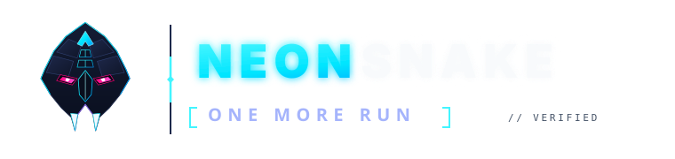
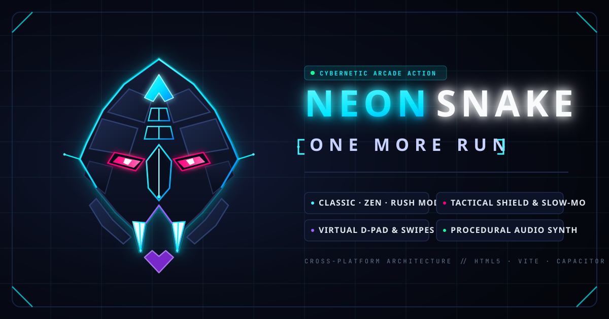

<div align="center">



# NEON SNAKE — ONE MORE RUN

**A high-octane cybernetic arcade Snake game engineered for modern desktop browsers and Android mobile devices.**

[](https://www.typescriptlang.org/)
[](https://react.dev/)
[](https://vitejs.dev/)
[](https://tailwindcss.com/)
[](https://capacitorjs.com/)
[](https://developer.android.com/)
[](#testing)

[Features](#core-features) • [Game Modes](#game-modes) • [Controls](#controls) • [Architecture](#architecture) • [Getting Started](#getting-started) • [Android Guide](#android-development--build) • [Roadmap](#roadmap)

</div>

---

## Overview

**NEON SNAKE: ONE MORE RUN** reimagines the classic arcade snake formula as a sleek, precision cybernetic simulation. Featuring the approved **Apex Cyber-Viper** visual identity, hardware-accelerated 60 FPS Canvas 2D rendering, procedural Web Audio synthesis, and adaptive responsive controls for mobile and desktop, the game is built for reflex-intensive runs and high-score competition.

Built natively on **React 19**, **TypeScript**, **Tailwind CSS v4**, and **Capacitor 8**, NEON SNAKE runs seamlessly in responsive desktop browsers, mobile touch viewports, and native Android application environments (`com.cyberhorcrux.neonsnake`).

---

## Core Features

- **Apex Cyber-Viper Brand Identity**: Original geometric kinetic vector branding suite designed across 7 official SVG variants, custom application icons, and density-scaled Android launcher and splash resources.
- **Hardware-Accelerated 60 FPS Canvas Engine**: Pure, deterministic game engine decoupled from React's render cycle, rendering crisp DPR-aware geometry, dynamic snake chassis curves, energetic pulse rings, and high-performance particle cascades.
- **Dynamic Combo Multiplier**: Eating energy nodes within a rapid 3.2-second window escalates score multipliers (1x, 2x, 3x, 4x MAX) accompanied by synthesized harmonic chords and animated telemetry indicators.
- **Customizable Neon Chassis Skins**: 5 selectable chassis designs with distinct head optics and multi-segment body gradients:
  - **Cyber Cyan (Default)**: Cyan neural core with ultraviolet laser energy gradient.
  - **Matrix Emerald**: Phosphor-green terminal cascade with bright emerald core.
  - **Synth Sunset**: Outrun dusk neon aesthetic with orange, magenta, and violet tones.
  - **Hyper Violet**: High-frequency ultraviolet laser arc with vivid magenta optics.
  - **Solar Prestige**: Hyper-conductive gold alloy with warm amber solar flare accents.
- **Procedural Web Audio Synthesizer**: 100% procedural sound synthesis using the Web Audio API with zero external audio assets. Generates synthesized plucks, harmonic chimes, shield shatters, combo sweeps, and victory fanfares with volume and mute controls.
- **Pilot Dossier & Career Telemetry**: Comprehensive tracking of lifetime statistics (runs executed, cumulative score, highest run, food consumed, bonus stars, max combo, shields utilized, and boundary wraparounds) paired with 10 unlockable achievements.
- **Resilient Offline Persistence**: LocalStorage persistence with defensive JSON sanitization, schema migration, corruption recovery, and separate high-score tracking per mode.

---

## Game Modes

| Mode | Border Behavior | Speed Dynamics | Multiplier | Description |
|---|---|---|---|---|
| **CLASSIC** | Solid Walls | Incremental ramp (+4ms per food) | 1.0x Base | The authentic arcade reflex challenge. Impact with grid perimeter walls or snake body is fatal. |
| **ZEN** | Toroidal Wraparound | Smooth, relaxed tempo | 1.0x Base | Endless flow state. Boundaries wrap infinitely across opposing edges, ideal for meditation and rhythm play. |
| **RUSH** | Solid Walls | High starting velocity + rapid acceleration | 1.5x Bonus | High risk, high adrenaline. Accelerated tick rates and aggressive scaling with a 1.5x score bonus. |

---

## Energy Nodes & Power-Ups

- 🟢 **Neon Core (+10 PTS)**: Standard energy node. Grows snake length by 1 segment and advances the simulation speed level for every 5 cores consumed.
- 🌟 **Bonus Star (+30 PTS)**: Rare, timed high-value energy core with an animated countdown ring. Disappears if not captured before expiration.
- ⏱️ **Chrono Shift (+15 PTS)**: Temporarily decelerates simulation speed by ~45% for 7.5 seconds, providing precision steering through narrow corridors.
- 🛡️ **Aegis Shield (+15 PTS)**: Generates a quantum energy barrier around the snake that absorbs exactly one fatal wall collision or self-overlap, keeping the run alive.

---

## Controls

The control architecture automatically adapts to the player's input medium, supporting keyboard, touch gestures, and virtual directional buttons.

### Desktop Controls

| Action | Primary Key | Alternate Key |
|---|---|---|
| **Move Up** | `W` | `Up Arrow` (`↑`) |
| **Move Down** | `S` | `Down Arrow` (`↓`) |
| **Move Left** | `A` | `Left Arrow` (`←`) |
| **Move Right** | `D` | `Right Arrow` (`→`) |
| **Pause / Resume** | `Spacebar` | `Escape` |
| **Instant Restart** | `R` | — |
| **Toggle Audio Mute** | `M` | — |
| **Confirm / Start** | `Enter` | — |

### Mobile & Touch Controls

NEON SNAKE offers three user-selectable control modes configurable in the **Settings** menu:

1. **Swipe Gestures (`swipe`)**: Smooth finger dragging or flicking across the arena canvas with an optimized 24-pixel directional delta threshold.
2. **Virtual D-Pad (`buttons`)**: Responsive on-screen directional buttons engineered to prevent control obstruction:
   - *Portrait Orientation*: Scaled and docked below the square playfield.
   - *Landscape Orientation*: Docked in the right-hand gutter clearance zone, ensuring no overlap with HUD action buttons.
3. **Hybrid Mode (`both`)**: Simultaneously accepts both direct arena swipe gestures and virtual D-pad inputs.

---

## Screenshots & Visual Showcase

<div align="center">



</div>

> **Note on Visual Showcase Assets**:
> In accordance with project standards, all screenshot files in this repository represent genuine, unedited captures from running builds. Gameplay captures, mobile portrait, and mobile landscape screenshots can be found or contributed to the [`docs/screenshots/`](./docs/screenshots/) directory. Refer to [`docs/screenshots/README.md`](./docs/screenshots/README.md) for capture specifications.

---

## Technology Stack

```
┌─────────────────────────────────────────────────────────────┐
│                       NEON SNAKE                            │
├────────────────────────────────┬────────────────────────────┤
│ User Interface & Orchestration │ React 19, TypeScript       │
│ Build & Development Tooling    │ Vite 8, Tailwind CSS 4     │
│ Rendering & Simulation         │ HTML5 Canvas 2D (60 FPS)   │
│ Audio Engine                   │ Procedural Web Audio API   │
│ Native Mobile Runtime          │ Capacitor 8 (Android SDK)  │
│ Unit Testing Suite             │ Node.js Test Runner        │
└────────────────────────────────┴────────────────────────────┘
```

- **React 19 (`^19.0.1`)**: Component-based application shell, reactive HUD overlays, accessible modal state management, and lifecycle synchronization.
- **TypeScript (`^7.0.2` / ES2022)**: Complete type safety across deterministic game state, physics calculations, skin definitions, and telemetry data models.
- **Vite 8 (`^8.3.0`)**: Instant development server with HMR and high-performance Rollup production bundling.
- **Tailwind CSS 4 (`^4.3.3`)**: Global cybernetic styling, custom CSS variables for safe-area insets (`env(safe-area-inset-*)`), and responsive layout utilities.
- **HTML5 Canvas 2D**: Direct pixel-manipulation pipeline executing particle life cycles, glowing segment paths, and responsive aspect-ratio clamping.
- **Procedural Web Audio**: Zero-asset sound synthesizer generating dynamic oscillator waves, gain nodes, and harmonic intervals directly via code.
- **Capacitor 8 (`@capacitor/core`, `@capacitor/android`, `@capacitor/cli: ^8.6.0`)**: Cross-platform bridge connecting the web build to the Android native application wrapper (`com.cyberhorcrux.neonsnake`).
- **Node.js Native Test Runner (`node:test`)**: Zero-dependency automated test runner executing 79 unit tests in under 1 second.

---

## Architecture

The codebase enforces strict separation of concerns between deterministic game mechanics, presentation layers, audio synthesis, and persistence:

```
src/
├── assets/
│   └── branding/            # Approved Apex Cyber-Viper vector asset suite (7 SVGs)
├── components/
│   ├── branding/            # BrandLogo vector component & visual previewers
│   ├── GameOverModal.tsx    # Run termination summary, record celebration, and sharing
│   ├── HeaderHUD.tsx        # Minimal perimeter HUD displaying score, combo, and active buffs
│   ├── HowToPlayModal.tsx   # Tactical manual explaining controls and power-up nodes
│   ├── PauseModal.tsx       # System pause dialog with real-time run telemetry
│   ├── SettingsModal.tsx    # Audio volume, skin chassis, graphics, and control mode toggles
│   ├── StatsModal.tsx       # Pilot Dossier career telemetry and achievement progression
│   ├── TitleScreen.tsx      # Main launcher with BrandLogo emblem and mode selector
│   └── TouchDPad.tsx        # Responsive on-screen virtual directional buttons
├── game/
│   ├── audio.ts             # Procedural sound synthesizer (Web Audio API)
│   ├── constants.ts         # Centralized game tuning, tick intervals, and skin palettes
│   ├── controls.ts          # Swipe tracking and input-acceptance logic
│   ├── engine.ts            # Pure deterministic snake physics, turn queues, and collision logic
│   ├── persistence.ts       # LocalStorage schema validation and corruption recovery
│   ├── renderer.ts          # Canvas 2D neon drawing system and particle pool
│   ├── responsive.ts        # Square canvas dimensions and D-pad geometry calculations
│   ├── stats.ts             # Lifetime telemetry accumulator and achievement engine
│   └── types.ts             # TypeScript interfaces and domain type definitions
├── App.tsx                  # Root orchestrator managing game loop and screen states
├── index.css                # Tailwind CSS imports, theme variables, and cyber scrollbars
└── main.tsx                 # React application entry point
```

---

## Getting Started

### Prerequisites

- **Node.js**: Version 20.x or 22.x (Node.js 22 LTS recommended)
- **npm**: Version 10.x or higher

### Installation

1. Clone the repository:
   ```bash
   git clone https://github.com/cyber-Horcrux/Snake-Game.git
   cd Snake-Game
   ```

2. Install dependencies:
   ```bash
   npm install
   ```

3. Create the environment configuration file:
   ```bash
   cp .env.example .env
   ```

---

## Local Development

Start the Vite development server on port 3000:

```bash
npm run dev
```

The application will be accessible at `http://localhost:3000`.

### Type Checking & Linting

Run TypeScript type validation across the entire codebase:

```bash
npm run lint
```

*(Executes `tsc --noEmit` with zero errors).*

---

## Production Build

To compile and optimize the web application for production deployment:

```bash
npm run build
```

This compiles client bundles into the `dist/` directory with minified JavaScript, scoped CSS, and optimized vector branding assets.

To preview the production build locally:

```bash
npm run preview
```

---

## Android Development & Build

NEON SNAKE includes a pre-configured native Android application wrapper powered by Capacitor 8.

### Android Specifications

- **Application ID / Package**: `com.cyberhorcrux.neonsnake`
- **Minimum SDK**: Android API 24 (Android 7.0 Nougat)
- **Target SDK**: Android API 36
- **Compile SDK**: Android API 36
- **Version Code**: `2`
- **Version Name**: `1.1`
- **Launcher Icons**: Density-specific adaptive icons across `mdpi`, `hdpi`, `xhdpi`, `xxhdpi`, and `xxxhdpi`
- **Splash Screens**: Branded portrait and landscape splash screens across all five densities

### Android Prerequisites

- **Android Studio**: Ladybug (2024.2.1+) or newer
- **Java Development Kit**: JDK 21+
- **Android SDK Platforms**: Platform 36 and Android Build-Tools 36.x installed via Android Studio SDK Manager

### Synchronization & Build Workflow

1. Build the production web distribution:
   ```bash
   npm run build
   ```

2. Sync web assets and plugins to the native Android project:
   ```bash
   npx cap sync android
   ```

3. Open the Android project in Android Studio:
   ```bash
   npx cap open android
   ```

4. Assemble the release APK (from a terminal with configured Android SDK and JDK):
   ```bash
   cd android
   ./gradlew assembleRelease
   ```

> **Build Environment Notice**:
> Headless container environments without the Android SDK/JDK cannot execute Gradle compilation tasks directly. Native release compilation and physical device verification are executed in a configured local Android development environment.

---

## Testing

NEON SNAKE maintains an automated test suite executed via the native Node.js test runner (`node:test` and `node:assert/strict`):

```bash
npm test
```

### Test Coverage Summary (79 Passing Tests)

- **Deterministic Game Engine (`engine.test.ts`)**: Direction reversals (180° prevention), rapid 2-turn buffering, food consumption and growth timing, tail-vacating edge cases, self-collision detection, solid wall impacts in Classic, toroidal boundary wrapping in Zen, Aegis Shield collision absorption, full-grid victory state, slow-mo tick intervals, speed level advancement, combo multiplier escalation, and timed food decay.
- **Controls & Gestures (`controls.test.ts`)**: Directional calculation from touch coordinates, minimum swipe threshold enforcement, and touch/keyboard coexistence.
- **Responsive Layout & D-Pad Geometry (`responsive.test.ts`)**: 1:1 canvas aspect ratio enforcement across 14 distinct viewport sizes, small-screen scaling down to mobile viewports, portrait bottom-docking geometry, landscape right-gutter docking, and complete button clearance verification.
- **Persistence & Storage Failsafes (`persistence.test.ts`)**: Fallback defaults on null/empty storage, corruption recovery for malformed JSON, independent high-score updates per mode, settings sanitization, and storage exception resilience.
- **Pilot Dossier & Telemetry (`stats.test.ts`)**: Cumulative lifetime telemetry calculation, achievement badge unlock criteria (First Bite, Centurion, Rush Hour, Warp Runner, Aegis Master), and factory reset integrity.
- **Brand Identity & UI Rebrand (`branding.test.ts`)**: Verification of all 7 vector brand assets, strict SVG XML validation without raster embeds, BrandLogo component export validation, web metadata and social cards in `index.html`, PWA manifest compliance, Android density icons, and cross-screen integration of BrandLogo in TitleScreen, PauseModal, GameOverModal, StatsModal, and HowToPlayModal.

---

## Roadmap

### Completed Milestones
- [x] **Phase 1: Responsive Optimization**: Landscape and portrait virtual D-pad architecture, swipe gesture tracking, and adaptive canvas scaling.
- [x] **Phase 2, Task 1–2: Master Brand Identity**: Geometric kinetic **Apex Cyber-Viper** vector suite across 7 SVG variants and `BrandLogo` component.
- [x] **Phase 2, Task 3: Metadata Branding**: Complete OpenGraph, Twitter card, PWA manifest, and HTML header branding overhaul.
- [x] **Phase 2, Task 4: Android Launcher & Splash Overhaul**: Replaced Android launcher icons (standard, round, adaptive) and splash screens across 5 density buckets.
- [x] **Phase 2, Task 5: Complete In-Game UI Rebrand**: Comprehensive styling overhaul of TitleScreen, HeaderHUD, PauseModal, GameOverModal, SettingsModal, StatsModal, and HowToPlayModal.
- [x] **Phase 2, Task 6: Repository Showcase**: Professional technical documentation, visual assets catalog, and developer guide.

### Planned Future Enhancements
The following features are scheduled for subsequent development phases:

1. **XP & Pilot Progression**: Tiered leveling system awarding experience points based on food consumed, run survival time, and combo mastery.
2. **Customization Expansion**: Unlockable particle trails, arena grid themes (Cyberpunk, Synthwave, Monolith), and exclusive snake chassis variants.
3. **Advanced Achievement System**: Multi-tiered achievement milestones with custom visual badges.
4. **Daily & Weekly Reflex Challenges**: Seeded procedural runs with fixed modifiers and global daily high-score targets.
5. **Maze Mode**: Shifting and static architectural obstacle walls requiring rapid navigational routing.
6. **Survival Mode**: Progressively shrinking arena boundary perimeter forcing tight turns and spatial awareness.
7. **Time Attack Mode**: 120-second fixed-duration high-score sprints with accelerated bonus node spawns.

---

## Contributing

Contributions that align with NEON SNAKE's architecture and performance standards are welcome:

1. Fork the repository (`https://github.com/cyber-Horcrux/Snake-Game`).
2. Create a feature branch:
   ```bash
   git checkout -b feature/pilot-customization
   ```
3. Commit your changes with clear, descriptive commit messages.
4. Ensure all automated tests and type checks pass:
   ```bash
   npm run lint && npm test && npm run build
   ```
5. Open a Pull Request against the `main` branch.

---

## License

This project currently operates without a formal open-source license. All intellectual property, branding, code, and design assets are maintained by the project maintainers. An open-source license (such as MIT or Apache 2.0) will be designated prior to general public release.
